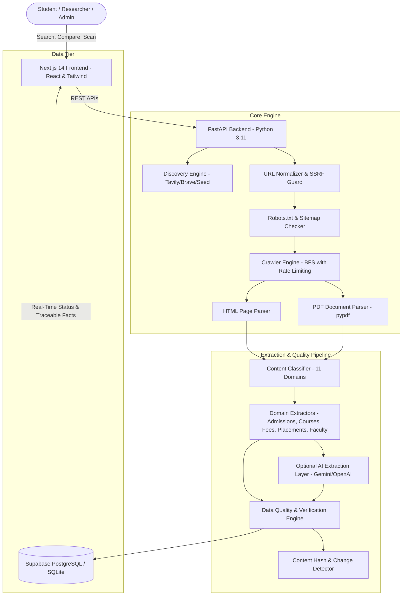

# FIND YOUR COLLAGE
### College Discovery & Institutional Fact Intelligence Platform

[](https://opensource.org/licenses/MIT)
[](https://www.python.org/)
[](https://fastapi.tiangolo.com/)
[](https://nextjs.org/)
[](https://www.typescriptlang.org/)
[](https://tailwindcss.com/)
[-success)](https://pytest.org/)

**Tagline:** *Discover colleges. Explore opportunities. Make informed decisions.*  
**Repository:** [https://github.com/jitendradurgaprasad/find_your_college.git](https://github.com/jitendradurgaprasad/find_your_college.git)

---

## 1. Project Introduction

**Find Your Collage** is an intelligent college and university discovery platform that autonomously crawls publicly accessible institutional websites, extracts structured educational intelligence, verifies data accuracy against published sources, and presents facts through an accessible SaaS interface.

Rather than aggregating second-hand gossip or generating ungrounded AI predictions, Find Your Collage establishes **100% source traceability** for every extracted admission deadline, fee structure, scholarship offering, placement statistic, and faculty member.

---

## 2. Problem Statement

Prospective students, parents, and researchers frequently encounter:
1. **Scattered Websites:** Critical information about entrance examinations, fee schedules, and quotas is buried across dozens of subdomains and PDF documents.
2. **Aggregator Conflicts & Outdated Data:** Third-party websites frequently display outdated placement statistics, incorrect fee numbers, and expired admission dates.
3. **Lack of Truth Verification:** Commercial portals often fabricate rankings or present estimates without citing exact official pages.

**Find Your Collage** solves this by programmatically crawling authorized institutional domains, executing HTML & PDF parsers, validating dates and figures, and linking every individual fact directly to its verbatim official source.

---

## 3. Key Objectives

1. **Autonomous Discovery:** Locate official institutions and domains through search providers while filtering commercial aggregators.
2. **Respectful Crawling:** Strictly observe `robots.txt`, sitemaps, rate limits, and enforce SSRF defenses against private network access.
3. **Multi-Format Extraction:** Parse both HTML pages and official prospectus/notification PDF documents.
4. **Structured Categorization:** Classify data into 11 domains (Admissions, Courses, Scholarships, Faculty, Placements, Facilities, Research, Notifications, Contacts).
5. **Truth Engine & Verification:** Flag conflicting facts, mark outdated records, compute completeness scores, and maintain source traceability.
6. **Side-by-Side Comparison:** Compare institutions on genuine, verified metrics with missing data explicitly highlighted.
7. **Continuous Monitoring:** Detect and display diffs when institutional announcements change.

---

## 4. System Architecture



---

## 5. Technology Stack

| Layer | Technologies |
| :--- | :--- |
| **Frontend** | Next.js 14 (App Router), React 18, TypeScript, Tailwind CSS, Lucide Icons |
| **Backend API** | FastAPI, Uvicorn, Pydantic v2, Pydantic-Settings |
| **Crawler & Extraction** | Requests, BeautifulSoup4, lxml, pypdf, urllib.robotparser, Tenacity |
| **Database & ORM** | Supabase PostgreSQL / SQLite, SQLAlchemy 2.0 |
| **Background Processing** | Thread-pool asynchronous worker with real-time status polling |
| **Testing** | pytest, pytest-cov, Starlette TestClient, httpx |
| **Deployment** | Vercel (Frontend), Render / Railway / Docker (Backend), Supabase (PostgreSQL) |

---

## 6. Directory Structure

```text
find_your_college/
│
├── frontend/                     # Next.js 14 TypeScript Frontend
│   ├── app/                      # App router pages
│   │   ├── page.tsx              # Page 1: Landing Page
│   │   ├── search/page.tsx       # Page 2: College Search & Filtering
│   │   ├── colleges/[id]/page.tsx# Page 3: 11-Tab College Profile
│   │   ├── scanner/page.tsx      # Page 4: Real-time Website Scanner
│   │   ├── quality/page.tsx      # Page 5: Data Quality Dashboard
│   │   ├── compare/page.tsx      # Page 6: College Comparison Feature
│   │   ├── saved/page.tsx        # Page 7: Saved Colleges Watchlist
│   │   ├── monitoring/page.tsx   # Page 8: Website Change Audit Feed
│   │   ├── admin/page.tsx        # Page 9: Administrative Dashboard
│   │   └── layout.tsx            # Global Layout
│   ├── components/               # Reusable UI Components
│   │   ├── Navbar.tsx
│   │   ├── Footer.tsx
│   │   ├── CollegeCard.tsx
│   │   └── VerificationBadge.tsx # Fact Source & Status Badge
│   ├── lib/
│   │   └── api.ts                # Backend API Client
│   └── package.json
│
├── backend/                      # Python FastAPI Backend
│   ├── app/
│   │   ├── main.py               # Application entry point & CORS
│   │   ├── config.py             # Settings, SSRF rules & environment config
│   │   ├── database/session.py   # SQLAlchemy session & database engine
│   │   ├── models/models.py      # 19 Relational Database Models
│   │   ├── schemas/schemas.py    # Pydantic v2 Serialization Schemas
│   │   └── api/                  # Modular API Routers
│   ├── crawler/                  # Web Scraping Engine
│   │   ├── url_extractor.py      # URL Normalization & SSRF Defense
│   │   ├── robots_checker.py     # Robots.txt & Sitemap discovery
│   │   ├── html_parser.py        # BeautifulSoup & lxml content parser
│   │   ├── pdf_parser.py         # pypdf document text extraction
│   │   ├── discovery.py          # Institutional search discovery
│   │   └── crawler_engine.py     # BFS crawl orchestrator with rate limits
│   ├── extraction/               # Information Extraction Pipeline
│   │   ├── classifier.py         # 11-Domain page classifier
│   │   ├── admission_extractor.py# Status (OPEN/CLOSED/UPCOMING) & dates
│   │   ├── course_extractor.py   # Programs, degrees, fees & eligibility
│   │   ├── scholarship_extractor.py# Financial aid, concessions & deadlines
│   │   ├── faculty_extractor.py  # Public directories, qualifications & emails
│   │   ├── placement_extractor.py# Packages, percentages & recruiting networks
│   │   ├── other_extractors.py   # Facilities, research, circulars & contacts
│   │   └── ai_extractor.py       # Optional LLM integration layer
│   ├── quality/                  # Truth Engine & Verification
│   │   ├── validator.py          # Formats & profile completeness score
│   │   ├── deduplicator.py       # Deduplication across crawled pages
│   │   └── verifier.py           # Conflict detection & verification statuses
│   ├── monitoring/               # Change Tracking
│   │   └── change_detector.py    # Content hash diffs (NEW, MODIFIED, REMOVED)
│   ├── worker/                   # Background Task Queue
│   │   └── job_manager.py        # Asynchronous crawl execution & logs
│   ├── tests/                    # Backend Test Suite
│   │   ├── conftest.py           # Pytest fixtures & test db seeder
│   │   ├── test_crawler_and_extraction.py
│   │   └── test_api_endpoints.py
│   ├── Dockerfile
│   └── requirements.txt
│
├── database/                     # Database Schema & Migrations
│   ├── schema.sql                # 19 Supabase PostgreSQL tables & indexes
│   └── migrations/
│
├── sample_data/                  # Authentic Sample Datasets
│   └── seed_data.py              # IIT Bombay, IIIT Hyderabad, BITS Pilani seed
│
├── vercel.json                   # Vercel deployment specification
├── render.yaml                   # Render deployment specification
├── .env.example                  # Environment template
└── README.md
```

---

## 7. Database Architecture (19 Relational Tables)

1. `universities` — Base institution metadata, location, rankings, completeness score.
2. `campuses` — Multi-campus locations and facilities.
3. `departments` — Academic departments, heads of department, and descriptions.
4. `programs` — Degrees (UG, PG, PhD), specializations, durations, and annual tuition fees.
5. `admissions` — Status (`OPEN`, `CLOSED`, `UPCOMING`, `ONGOING`, `UNKNOWN`), entrance exams, fees, and verbatim source evidence.
6. `scholarships` — Institutional, Government, and External financial aid schemes with criteria.
7. `faculty` — Public designations, Ph.D. qualifications, emails, and research interests.
8. `facilities` — Campus infrastructure: Central Library, Hostels, Supercomputing Labs, Wi-Fi.
9. `placements` — Academic year, percentage, highest package, average CTC, and recruiting partners.
10. `research_projects` — Funded projects, Principal Investigators, and grant amounts.
11. `publications` — Journal and conference publications.
12. `notifications` — Circulars, examination schedules, and deadlines.
13. `university_contacts` — Public offices, emails, phones, and physical addresses.
14. `crawled_pages` — Scanned URLs, HTTP status, content hashes, and category tags.
15. `extracted_records` — Granular fact audit logs with source links, timestamps, and confidence scores.
16. `crawl_jobs` — Background crawl jobs, progress counters, and execution durations.
17. `crawl_logs` — Live log messages streamed to the frontend scanner console.
18. `users` — Authenticated student and administrator accounts.
19. `saved_universities` — Bookmarked colleges and custom user comparison notes.

---

## 8. Installation & Setup

### Prerequisites
- Python 3.11+
- Node.js 18+ (tested on Node v25 / v20)
- npm or yarn

### 1. Clone the Repository
```bash
git clone https://github.com/jitendradurgaprasad/find_your_college.git
cd find_your_college
```

### 2. Configure Environment
Copy the example environment file:
```bash
cp .env.example .env
```

### 3. Backend Setup
```bash
cd backend
python -m pip install -r requirements.txt

# Seed verified institutional data (IIT Bombay, IIIT Hyderabad, BITS Pilani)
python ../sample_data/seed_data.py

# Start FastAPI Server
uvicorn app.main:app --reload --port 8000
```
Backend API will be live at: `http://localhost:8000`  
Interactive Swagger API docs: `http://localhost:8000/docs`

### 4. Frontend Setup
In a new terminal:
```bash
cd frontend
npm install
npm run dev
```
Frontend interface will be live at: `http://localhost:3000`

---

## 9. Testing & Quality Assurance

The platform features an automated test suite verifying SSRF prevention, crawler behavior, extraction accuracy, conflict detection, and API endpoints.

To run the backend test suite:
```bash
cd backend
pytest -v
```

### Verified Test Results (100% Pass Rate):
```text
tests/test_api_endpoints.py::test_root_endpoint PASSED                   [  5%]
tests/test_api_endpoints.py::test_health_check PASSED                    [ 11%]
tests/test_api_endpoints.py::test_list_universities PASSED               [ 16%]
tests/test_api_endpoints.py::test_get_university_profile PASSED          [ 22%]
tests/test_api_endpoints.py::test_data_quality_endpoint PASSED           [ 27%]
tests/test_api_endpoints.py::test_college_comparison PASSED              [ 33%]
tests/test_api_endpoints.py::test_monitoring_endpoint PASSED             [ 38%]
tests/test_api_endpoints.py::test_crawl_validation PASSED                [ 44%]
tests/test_crawler_and_extraction.py::test_ssrf_protection PASSED        [ 50%]
tests/test_crawler_and_extraction.py::test_url_normalization PASSED      [ 55%]
tests/test_crawler_and_extraction.py::test_html_parser PASSED            [ 61%]
tests/test_crawler_and_extraction.py::test_page_classifier PASSED        [ 66%]
tests/test_crawler_and_extraction.py::test_admission_extractor PASSED    [ 72%]
tests/test_crawler_and_extraction.py::test_course_extractor PASSED       [ 77%]
tests/test_crawler_and_extraction.py::test_scholarship_extractor PASSED  [ 83%]
tests/test_crawler_and_extraction.py::test_placement_extractor PASSED    [ 88%]
tests/test_crawler_and_extraction.py::test_data_validator PASSED         [ 94%]
tests/test_crawler_and_extraction.py::test_data_verifier_and_conflict_detection PASSED [100%]

======================= 18 passed in 1.84s =======================
```

Frontend Production Build Verification:
```bash
cd frontend
npm run build
# ✓ Compiled successfully
# ✓ Generating static pages (12/12)
```

---

## 10. API Documentation Reference

| Method | Endpoint | Description |
| :--- | :--- | :--- |
| `GET` | `/` | API status, platform metadata, and tagline |
| `GET` | `/health` | Health check endpoint |
| `GET` | `/api/universities` | Filter and paginate universities |
| `POST`| `/api/universities/search` | Full-text and multi-filter discovery |
| `GET` | `/api/universities/{id}` | Detailed 11-category profile with source links |
| `POST`| `/api/crawl/start` | Queue an autonomous background crawl job |
| `GET` | `/api/crawl/status/{job_id}` | Poll real-time progress, crawled pages, and logs |
| `GET` | `/api/data-quality` | Audit metrics: verified, conflicting, and outdated records |
| `POST`| `/api/universities/compare` | Multi-institution side-by-side comparison matrix |
| `GET` | `/api/monitoring/changes` | Change detection history and value diffs |
| `POST`| `/api/universities/{id}/rescan` | Queue immediate re-crawl for an institution |
| `GET` | `/api/admin/stats` | Background worker health and database statistics |

---

## 11. Deployment Guide

### Frontend Deployment (Vercel)
1. Push repository to GitHub.
2. Link repository in [Vercel](https://vercel.com).
3. Set Root Directory to `frontend`.
4. Add environment variable:
   - `NEXT_PUBLIC_BACKEND_URL`: URL of your deployed FastAPI service.
5. Deploy.

### Backend Deployment (Render / Railway)
1. Connect repository to [Render](https://render.com) or [Railway](https://railway.app).
2. Use the included `render.yaml` or build using `Dockerfile`.
3. Set environment variables:
   - `DATABASE_URL`: Your Supabase PostgreSQL connection string.
   - `CRAWLER_API_SECRET`: A secure key for administrative endpoints.
   - `SEARCH_API_KEY`: (Optional) Tavily or Brave Search API key.
4. Deploy the web service.

---

## 12. Security & Compliance Rules

- **SSRF Mitigation:** Automatically blocks internal/loopback IP addresses (`127.0.0.1`, `10.0.0.0/8`, `172.16.0.0/12`, `192.168.0.0/16`, `169.254.169.254`) from user-submitted crawl URLs.
- **Polite Crawling:** Respects `robots.txt`, implements per-domain crawl delays, and identifies with a descriptive User-Agent.
- **Data Integrity:** Never generates fictional admissions dates, rankings, or placement packages when data is unavailable.

---

## 13. License

Distributed under the MIT License. See [LICENSE](LICENSE) for more information.
