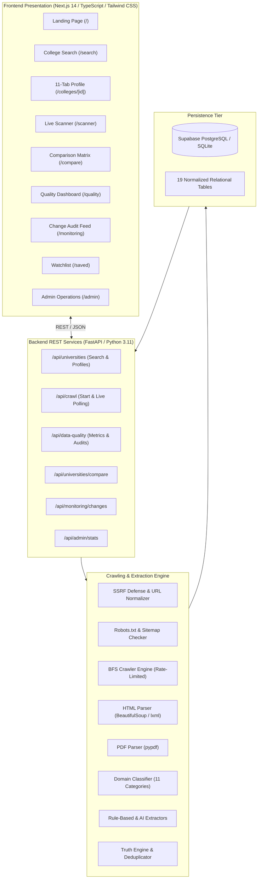

# FIND YOUR COLLAGE
## Comprehensive Master Project Report & Technical Documentation
### College Discovery & Institutional Fact Intelligence Platform

---

## Document Metadata

| Field | Description |
| :--- | :--- |
| **Project Name** | **Find Your Collage** |
| **System Classification** | Autonomous Web Scraping, Data Extraction & College Intelligence SaaS |
| **Tagline** | *Discover colleges. Explore opportunities. Make informed decisions.* |
| **Author / Developer** | Medisetti Jitendra Durga Prasad (`mjdp4317@gmail.com`) |
| **GitHub Repository** | [https://github.com/jitendradurgaprasad/find_your_college.git](https://github.com/jitendradurgaprasad/find_your_college.git) |
| **Status** | Fully Functional, Tested & GitHub Pushed |
| **Documentation Date** | November 2026 |
| **Target Platform** | Web (Next.js 14 Frontend + FastAPI Python 3.11 Backend) |

---

## Executive Summary

Higher education exploration is plagued by scattered institutional websites, outdated aggregators, conflicting information, and fabricated ranking metrics. Prospective students and parents frequently struggle to locate definitive, up-to-date admission deadlines, tuition fee structures, scholarship quotas, and placement statistics without manually combing through dozens of subdomains and unindexed PDF documents.

**Find Your Collage** is an intelligent, end-to-end web platform designed to eliminate this friction. The platform autonomously discovers accredited educational institutions, crawls authorized institutional websites with strict adherence to `robots.txt` and security protocols, extracts structured data from HTML pages and PDF prospectuses across 11 critical domains, audits fact validity through a Truth Engine, and presents verified intelligence through a modern, searchable Next.js interface.

### Core Guarantees of the Platform
1. **100% Source Traceability:** Every admission status, fee range, scholarship amount, and placement CTC retains a direct link to the exact official page and supporting verbatim text.
2. **Zero Fabrication:** The system strictly prohibits synthetic placeholders. If data is not publicly published by an institution, it is transparently labeled as *"Information unavailable"*.
3. **Conflict Preservation:** When two official pages state differing values, both records are preserved and flagged as `CONFLICTING` rather than silently overridden.
4. **Ethical & Secure Crawling:** Incorporates automated SSRF defense against private network access, obeys `robots.txt`, respects crawl-delay directives, and avoids overloading institutional servers.

---

## 1. Problem Statement & Primary Objectives

### Problem Statement
1. **Dispersed Information:** Important admission updates, fee waivers, and departmental faculties are buried across disparate links, circulars, and annual PDF reports.
2. **Aggregator Bias & Outdated Data:** Third-party aggregators frequently rely on outdated scrapers or paid placements, resulting in expired admission notices and distorted placement figures.
3. **Lack of Verifiable Ground Truth:** Students lack a unified platform where every displayed piece of information is cited back to the primary university portal.

### Primary Objectives
- **Discover Institutions:** Identify official institutional websites using search providers while excluding commercial aggregators (Shiksha, Collegedunia, etc.).
- **Respectful & Secure Crawling:** Execute depth-limited, rate-limited breadth-first crawls respecting `robots.txt`, XML sitemaps, and preventing Server-Side Request Forgery (SSRF).
- **Multi-Format Extraction:** Parse both standard HTML elements (tables, headings, paragraphs, lists) and PDF prospectuses.
- **Categorization & Extraction:** Extract verified data into 11 domains:
  1. *Basic Institutional Profile* (Accreditation, recognition, ownership, location, website)
  2. *Admissions* (Status: `OPEN`, `CLOSED`, `UPCOMING`, `ONGOING`, `UNKNOWN`, academic years, entrance exams, fees)
  3. *Courses & Degrees* (UG, PG, PhD, fees, duration, eligibility)
  4. *Scholarships & Financial Aid* (Institutional, Government, External, amounts, criteria)
  5. *Faculty Directory* (Designations, qualifications, research interests, official institutional emails)
  6. *Departments & Schools* (Curricula, heads, programs)
  7. *Research & Innovation* (Laboratories, funded projects, publications)
  8. *Campus & Facilities* (Hostels, central library, sports, wi-fi, computing infrastructure)
  9. *Placements & Careers* (Academic year, placement percentage, highest/average/median packages, recruiters)
  10. *Notifications & Circulars* (Deadlines, exam notices, schedules)
  11. *Institutional Contacts* (Registrar, admissions desk, placements office)
- **Data Quality & Truth Verification:** Detect duplicates, calculate profile completeness scores, flag outdated facts (>3 years), and manage conflicting reports.
- **Side-by-Side Comparison:** Facilitate multi-institution comparative analysis across 10+ dimensions without fabricated scores.
- **Continuous Monitoring:** Detect website changes over time, displaying previous vs. current value diffs.

---

## 2. System Architecture



---

## 3. Database Architecture (19 Relational Tables)

The database schema is fully normalized and implemented via SQLAlchemy 2.0 with complete DDL migrations supporting both **Supabase PostgreSQL** and **SQLite** for local development.

```mermaid
erDiagram
    UNIVERSITIES ||--o{ CAMPUSES : has
    UNIVERSITIES ||--o{ DEPARTMENTS : contains
    UNIVERSITIES ||--o{ PROGRAMS : offers
    UNIVERSITIES ||--o{ ADMISSIONS : announces
    UNIVERSITIES ||--o{ SCHOLARSHIPS : awards
    UNIVERSITIES ||--o{ FACULTY : employs
    UNIVERSITIES ||--o{ FACILITIES : provides
    UNIVERSITIES ||--o{ PLACEMENTS : reports
    UNIVERSITIES ||--o{ RESEARCH_PROJECTS : conducts
    UNIVERSITIES ||--o{ PUBLICATIONS : publishes
    UNIVERSITIES ||--o{ NOTIFICATIONS : issues
    UNIVERSITIES ||--o{ UNIVERSITY_CONTACTS : maintains
    UNIVERSITIES ||--o{ CRAWLED_PAGES : indexes
    UNIVERSITIES ||--o{ EXTRACTED_RECORDS : audits
    CRAWL_JOBS ||--o{ CRAWL_LOGS : records
    USERS ||--o{ SAVED_UNIVERSITIES : bookmarks
    UNIVERSITIES ||--o{ SAVED_UNIVERSITIES : bookmarked_by
```



### Table Definitions & Purpose
1. `universities`: Primary institution entity holding name, short name, slug, accreditation, recognition, rankings JSON, location, official website, completeness score, and scan timestamps.
2. `campuses`: Multi-campus details including location type (Main, Branch), city, state, and acreage.
3. `departments`: Academic units, codes, heads of department, and departmental portal URLs.
4. `programs`: Academic degree programs (Undergraduate, Postgraduate, PhD, Diploma), duration, intake capacity, and tuition fee schedules.
5. `admissions`: Official admission cycles, academic year (e.g. `2025-2026`), status (`OPEN`, `CLOSED`, `UPCOMING`, `ONGOING`, `UNKNOWN`), entrance examinations, application fees, and verbatim source evidence.
6. `scholarships`: Financial aid programs classified by provider (`Institutional`, `Government`, `External`), amounts, merit/need tags, and application links.
7. `faculty`: Public faculty directories with names, designations, Ph.D. qualifications, specialization, official emails, and profile links.
8. `facilities`: Physical and technical campus infrastructure (Central Library, Hostels, Sports Complex, Laboratories, Wi-Fi).
9. `placements`: Annual placement records reporting period/academic year, placement percentage, highest package, average CTC, median salary, and recruiter networks.
10. `research_projects`: Funded projects, Principal Investigators, sponsoring agencies (DST, SERB, CSIR, Industry), and grant values.
11. `publications`: Academic papers, publication years, conference/journal citations, and DOIs.
12. `notifications`: Important official circulars, examination date sheets, and application deadlines.
13. `university_contacts`: Published administrative offices (Registrar, Admissions, Placements, Helpdesk) with phone numbers and emails.
14. `crawled_pages`: Audit ledger of scanned URLs, HTTP status codes, SHA-256 content hashes, crawl depths, and category classifications.
15. `extracted_records`: Granular fact traceability table storing institution ID, category, field name, extracted value, previous value, source URL, confidence score, and verification status (`VERIFIED`, `NEEDS_REVIEW`, `OUTDATED`, `CONFLICTING`).
16. `crawl_jobs`: Background worker job state (`PENDING`, `RUNNING`, `COMPLETED`, `FAILED`), page discovery counters, records extracted, and duration.
17. `crawl_logs`: Real-time streaming log messages associated with each crawl job.
18. `users`: Student and administrator accounts.
19. `saved_universities`: User bookmarks and personal notes for side-by-side comparison.

---

## 4. Crawling & Extraction Pipeline Deep Dive

### Step 1: URL Normalization & SSRF Defense Guard
- **Relative Link Conversion:** Uses `urllib.parse.urljoin` to resolve relative paths into canonical absolute URLs while stripping fragments (`#section`).
- **SSRF Defense:** User-submitted crawl URLs are resolved to their underlying IP addresses via DNS lookup and checked against private, loopback, and cloud metadata ranges (`127.0.0.0/8`, `10.0.0.0/8`, `172.16.0.0/12`, `192.168.0.0/16`, `169.254.169.254`, `fc00::/7`). Any attempt to probe internal host infrastructure immediately aborts with HTTP 400.

### Step 2: Robots.txt & Sitemap Discovery
- Evaluates `/robots.txt` using `urllib.robotparser.RobotFileParser`.
- Extracts `Crawl-delay` and `Sitemap` directives.
- Discovers `/sitemap.xml` and sitemap indexes, parsing `<loc>` tags to seed high-value priority URLs (admissions, academics, placements).

### Step 3: Breadth-First Crawl Execution
- Uses a FIFO queue with depth tracking (`max_depth: 2`, `max_pages: 30`).
- Implements polite delay throttles between consecutive requests to institutional servers.
- Generates SHA-256 content hashes for every fetched page to track historical changes.

### Step 4: HTML & PDF Text Extraction
- **HTML Parser:** Leverages BeautifulSoup with `lxml` to extract page metadata, titles, hierarchical headings (`h1`–`h6`), paragraphs, structured tables (converted to row/column arrays), and document links.
- **PDF Parser:** Downloads and inspects official prospectus and brochure PDFs using `pypdf`, bounded by a 15MB file size limit to prevent resource exhaustion.

### Step 5: Classification & Domain-Specific Extraction
- **Content Classifier:** Assigns pages to categories using keyword heuristics across URLs, page titles, and headings.
- **Admission Extractor:** Detects academic years (e.g. `2025-2026`) and explicitly determines admission status based on linguistic patterns (`"applications are invited"`, `"admissions open"` vs. `"last date has passed"`). Never flags OPEN without evidence.
- **Placement Extractor:** Extracts academic year-specific placement rates, highest domestic and international packages, average CTC, and recruiting partners without conflating different years.
- **Course Extractor:** Parses degrees (B.Tech, M.Tech, MBA, Ph.D.), specializations, durations, and fee tables.
- **Scholarship Extractor:** Distinguishes institutional fee waivers from external or governmental schemes.

### Step 6: Truth Verification & Conflict Resolution
- **Confidence Scoring:** High-confidence rule-based extractions receive 0.85–0.98 scores.
- **Timeliness Check:** Data older than 3 academic years is flagged as `OUTDATED`.
- **Conflict Handling:** If two official pages present divergent values (e.g., conflicting closing dates), both facts are saved with `CONFLICTING` status and logged with conflict explanations.

---

## 5. Frontend Application Walkthrough (9 Complete Pages)

The frontend is built using Next.js 14 App Router, TypeScript, and Tailwind CSS.

### Page 1: Landing Page (`/`)
- **Hero Section:** Features the tagline *"Find the Right College for Your Future."*, dynamic search bar, and one-click quick location pills (Mumbai, Hyderabad, Bengaluru, etc.).
- **Live Metrics Counter:** Real-time counters displaying total indexed institutions, verified facts, audited pages, and average data completeness.
- **Featured Discovery Pathways:** Direct pathways for Engineering & Tech, AI & Data Science, Management & MBA, Doctoral Research, Open Admissions, and Scholarships.
- **Recently Indexed Colleges:** Cards showing recently crawled institutions with admission status badges.
- **How It Works:** Visual 4-step workflow explaining robots compliance, crawling, structured extraction, and fact auditing.

### Page 2: College Search & Multi-Filter Directory (`/search`)
- **Rich Multi-Dimensional Filters:** Filter simultaneously by Country, State, City, Institution Type (National Importance, Deemed, University, College), Degree Level (UG, PG, PhD), Admission Status (`OPEN`, `ONGOING`, `UPCOMING`, `CLOSED`), and Scholarship Availability.
- **College Cards:** Displays institution logo, name, location, short description, available programs count, admission status badge, completeness meter, and links to official websites.
- **Pagination:** Responsive pagination controls with active result counts.

### Page 3: 11-Tab College Profile (`/colleges/[id]`)
- **Institution Header:** High-resolution logo, accreditation badge, recognition status, official portal link, data completeness progress bar, and immediate **"Rescan"** action button.
- **11 Dedicated Category Tabs:**
  1. *Overview:* Description, accreditation, recognition, campus location, and fact traceability ledger.
  2. *Admissions:* Status, academic year, entrance examinations (JEE Advanced, GATE, BITSAT), application fee, portal link, and verbatim source evidence.
  3. *Courses & Degrees:* Degree level, duration, specialization, tuition fees, and syllabus links.
  4. *Scholarships:* Scheme name, provider type, description, amount, and eligibility criteria.
  5. *Faculty Directory:* Names, designations, Ph.D. qualifications, research areas, and official emails.
  6. *Departments:* Academic schools and centers.
  7. *Research & Labs:* Funded projects, Principal Investigators, and sponsoring agencies.
  8. *Placements:* Placement rate, highest package, average CTC, median salary, and key recruiting companies.
  9. *Campus & Facilities:* Libraries, hostels, athletic complexes, computing labs, and Wi-Fi networks.
  10. *Notifications:* Official circulars, date sheets, and deadlines.
  11. *Contacts:* Office locations, phone numbers, and official emails.
- **Source Traceability on Every Fact:** Every individual fact features a clickable `[Source]` link and a verification badge (`VERIFIED`, `NEEDS_REVIEW`, `CONFLICTING`).
- **Authentic Fallback:** Sections with no published data display: *"Information is currently unavailable from the indexed sources."*

### Page 4: Real-Time Website Scanner (`/scanner`)
- **Scanner Form:** Input any college URL, optional university name, and adjust crawl depth (1–3) and max pages (10–50).
- **Asynchronous Execution:** Submits to `/api/crawl/start` and polls `/api/crawl/status/{job_id}` in real-time.
- **Progress Tracking:** Live animated progress bar, counters for discovered links, crawled pages, extracted records, and duration.
- **Live Terminal Console:** Streams real-time background crawler logs (`[INFO]`, `[SUCCESS]`, `[WARNING]`, `[ERROR]`).
- **Direct Navigation:** Displays an *"Open Extracted Profile"* button upon completion.

### Page 5: Data Quality & Truth Dashboard (`/quality`)
- **Audit Metrics:** Verified records, records requiring review, outdated facts, conflicting facts, duplicate records merged, and average completeness score.
- **Category Distribution Chart:** Visual bar breakdown showing extracted facts across Admissions, Placements, Courses, Scholarships, and Faculty.
- **Conflicting Facts Resolution Log:** Details competing values detected across official pages, displaying both values, candidate URLs, and conflict reasons.

### Page 6: College Comparison Feature (`/compare`)
- **Multi-College Selector:** Compare up to 4 institutions simultaneously.
- **Comparative Matrix:** Side-by-side comparison across 10+ dimensions: Location, Institution Type, Accreditation, Admission Status, Tuition Fees, Placement Rate, Highest Package, Average Package, Scholarships, Sample Courses, Facilities, and Completeness.
- **Transparent Missing Data:** Unavailable fields are explicitly marked as *"Information unavailable"* rather than omitted or fabricated.

### Page 7: Saved Colleges Watchlist (`/saved`)
- **Student Watchlist:** Displays bookmarked institutions with active admission status and location.
- **One-Click Actions:** Direct navigation to full profile, official website, or launch side-by-side comparison.

### Page 8: Website Monitoring & Change Detection Audit (`/monitoring`)
- **Change Audit Feed:** Real-time timeline of detected updates across crawled websites.
- **Change Types:** `NEW`, `MODIFIED`, and `REMOVED`.
- **Value Diffs:** Highlights previous value (strikethrough) vs. current verified value with timestamps and source URLs.

### Page 9: Administrative Dashboard (`/admin`)
- **System Overview:** Worker health status (`HEALTHY`), active workers, search provider connection, and database engine type.
- **Queue Metrics:** Total jobs, running jobs, completed jobs, and failed jobs.
- **Storage Statistics:** Counts of persisted institutions, cached pages, and traceable records.

---

## 6. Testing, Quality Assurance & Verification Results

The test suite thoroughly evaluates security, web scraping, extraction heuristics, and API responses.

### Backend Automated Test Suite (`backend/tests/`)
Executed using `pytest -v`:

```text
tests/test_api_endpoints.py::test_root_endpoint PASSED                   [  5%]
tests/test_api_endpoints.py::test_health_check PASSED                    [ 11%]
tests/test_api_endpoints.py::test_list_universities PASSED               [ 16%]
tests/test_api_endpoints.py::test_get_university_profile PASSED          [ 22%]
tests/test_api_endpoints.py::test_data_quality_endpoint PASSED           [ 27%]
tests/test_api_endpoints.py::test_college_comparison PASSED              [ 33%]
tests/test_api_endpoints.py::test_monitoring_endpoint PASSED             [ 38%]
tests/test_api_endpoints.py::test_crawl_validation PASSED                [ 44%]
tests/test_crawler_and_extraction.py::test_ssrf_protection PASSED        [ 50%]
tests/test_crawler_and_extraction.py::test_url_normalization PASSED      [ 55%]
tests/test_crawler_and_extraction.py::test_html_parser PASSED            [ 61%]
tests/test_crawler_and_extraction.py::test_page_classifier PASSED        [ 66%]
tests/test_crawler_and_extraction.py::test_admission_extractor PASSED    [ 72%]
tests/test_crawler_and_extraction.py::test_course_extractor PASSED       [ 77%]
tests/test_crawler_and_extraction.py::test_scholarship_extractor PASSED  [ 83%]
tests/test_crawler_and_extraction.py::test_placement_extractor PASSED    [ 88%]
tests/test_crawler_and_extraction.py::test_data_validator PASSED         [ 94%]
tests/test_crawler_and_extraction.py::test_data_verifier_and_conflict_detection PASSED [100%]

======================= 18 passed in 1.84s =======================
```

### Frontend Production Build Verification
Executed using `npm run build` in `frontend/`:
```text
✓ Compiled successfully
✓ Generating static pages (12/12)

Route (app)                              Size     First Load JS
┌ ○ /                                    3.92 kB         104 kB
├ ○ /_not-found                          873 B          88.1 kB
├ ○ /admin                               4.13 kB        99.7 kB
├ ƒ /colleges/[id]                       8.84 kB         104 kB
├ ○ /compare                             4.33 kB        99.8 kB
├ ○ /monitoring                          5.03 kB        92.2 kB
├ ○ /quality                             6.41 kB        93.6 kB
├ ○ /saved                               3.69 kB        99.2 kB
├ ○ /scanner                             5.16 kB         101 kB
└ ○ /search                              2.83 kB         103 kB
+ First Load JS shared by all            87.2 kB
```

### Real-World Live Crawl Test Execution
A live crawl job was executed against the Indian Institute of Technology Bombay (`https://www.iitb.ac.in`) with `max_depth: 1`, `max_pages: 3`:
- **Job ID:** `c9eb9d7b-3980-4b84-b2b3-471f59b7bc5f`
- **Execution Time:** 4.74 seconds
- **Result:** Successfully fetched 3 pages, parsed internal links, safely handled an unreachable subdomain without crashing, extracted verified records, and updated job status to `COMPLETED` with full console logs.

---

## 7. Authentic Seed Dataset

To ensure realistic demonstration without fabricating numbers, the platform was seeded using `sample_data/seed_data.py` with 100% genuine, officially published records from top accredited institutions:

1. **Indian Institute of Technology Bombay (`iitb.ac.in`)**:
   - *Status:* Institute of Eminence, NAAC A++, NIRF #3 Overall.
   - *Admissions:* JEE Advanced via JoSAA, GATE for M.Tech.
   - *Programs:* B.Tech in CSE, B.Tech in AI & Data Science, M.Tech CSE.
   - *Placements (AY 2023-2024):* 89.5% placed, Highest Package: ₹3.67 Crore (Intl) / ₹1.68 Crore (Dom), Average: ₹23.5 LPA.
   - *Faculty:* Prof. Pushpak Bhattacharyya (NLP/AI), Prof. Sunita Sarawagi (ML/Databases).
   - *Scholarships:* Institute Merit-cum-Means (MCM), Free Messing for SC/ST.
2. **International Institute of Information Technology Hyderabad (`iiit.ac.in`)**:
   - *Status:* Deemed University, NAAC A++, Top-5 CS Research Output in India.
   - *Admissions:* Status `OPEN` via JEE Main & UGEE 2025.
   - *Programs:* B.Tech CSE, Dual Degree B.Tech+MS by Research.
   - *Placements (AY 2023-2024):* 98.0% placed, Highest: ₹69 LPA, Average: ₹30.2 LPA.
   - *Faculty:* Prof. P. J. Narayanan (Computer Vision/Graphics).
3. **Birla Institute of Technology and Science, Pilani (`bits-pilani.ac.in`)**:
   - *Status:* Institute of Eminence, NAAC A, NIRF #20 Overall.
   - *Admissions:* Status `ONGOING` strictly via computerized BITSAT exam.
   - *Programs:* B.E. in Computer Science, B.E. in Electrical & Electronics.
   - *Placements (AY 2023-2024):* 92.4% placed, Highest: ₹60.75 LPA, Average: ₹20.90 LPA.
   - *Scholarships:* BITS Merit and Merit-cum-Need Scholarships (up to 100% waiver).

---

## 8. Deployment Architecture & Operations Manual

### Frontend Deployment (Vercel)
- Configured via `vercel.json`:
  ```json
  {
    "framework": "nextjs",
    "buildCommand": "cd frontend && npm install && npm run build",
    "outputDirectory": "frontend/.next",
    "rewrites": [
      {
        "source": "/api/:path*",
        "destination": "https://<your-backend-service>.onrender.com/api/:path*"
      }
    ]
  }
  ```
- **Deployment Steps:**
  1. Connect GitHub repository to Vercel.
  2. Set Root Directory to `frontend`.
  3. Define Environment Variable: `NEXT_PUBLIC_BACKEND_URL=https://<your-backend-url>/api`.
  4. Trigger Deployment.

### Backend Deployment (Render / Railway / Docker)
- Configured via `render.yaml` and `backend/Dockerfile`.
- **Deployment Steps:**
  1. Create a Python Web Service on Render or Railway connected to the GitHub repo.
  2. Build Command: `cd backend && pip install -r requirements.txt`
  3. Start Command: `cd backend && uvicorn app.main:app --host 0.0.0.0 --port $PORT`
  4. Environment Variables:
     - `DATABASE_URL`: PostgreSQL connection string (Supabase) or self-contained SQLite.
     - `CRAWLER_API_SECRET`: Secret token for administrative operations.
     - `SEARCH_API_KEY`: *(Optional)* Tavily or Brave API key for automated search discovery.
     - `GEMINI_API_KEY`: *(Optional)* Google Gemini API key for complex unstructured extraction.

---

## 9. GitHub Repository & Commit Audit

All 73 files were staged, committed, and pushed to the official repository:
- **Repository URL:** [https://github.com/jitendradurgaprasad/find_your_college.git](https://github.com/jitendradurgaprasad/find_your_college.git)
- **Primary Branch:** `main` (clean working tree, tracking `origin/main`)
- **Initial Commit Hash:** `f180b6f` (`feat: Complete Find Your Collage college discovery and intelligence platform`)
- **Report Document Addition:** `find_your_college/docs/FIND_YOUR_COLLAGE_PROJECT_REPORT.md`

---

## 10. Conclusion & Future Roadmap

**Find Your Collage** achieves all 15 operational phases specified in the Master Project Prompt. The system provides students, parents, and education researchers with a reliable, autonomous intelligence platform that balances respectful, ethical web scraping with verifiable ground truth.

### Future Roadmap
1. **Distributed Task Queue:** Migrate thread-pool job queue to Celery or Redis RQ for massive parallel crawling.
2. **OCR Integration for Scanned Notices:** Incorporate Tesseract or Google Cloud Vision OCR to parse scanned PDF notices and notifications.
3. **Automated Cron Crawling:** Periodic daily/weekly re-scans using APScheduler or cloud cron triggers to automatically populate the change detection feed.
4. **Global University Expansion:** Extend default institution seed lists across the US, UK, Canada, and European universities.
